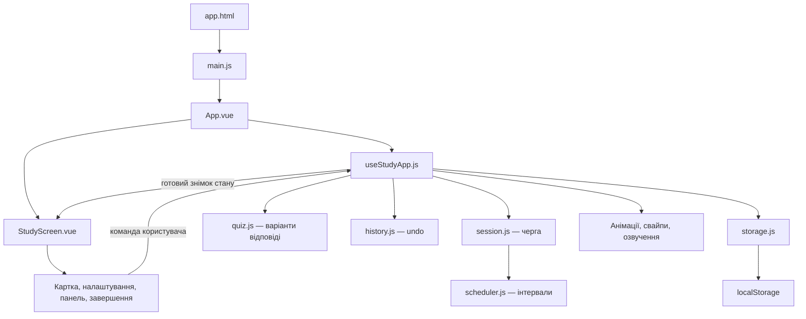
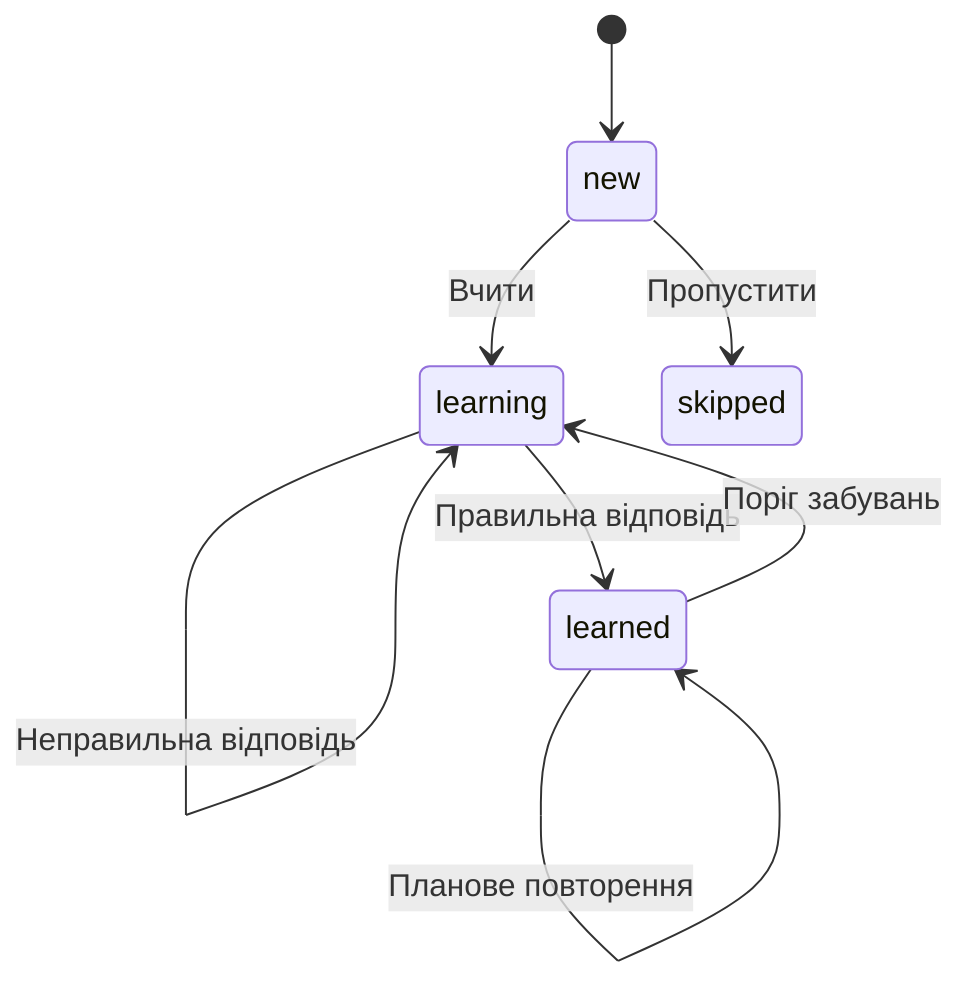

# Як пояснити Worder на захисті

## 1. Що робить проєкт

Worder допомагає вчити англійські слова за картками та повторювати їх через
зростаючі проміжки часу. Користувач обирає рівні A1–C1, переглядає нові слова,
відповідає на тести та бачить статистику. Каталог містить 5 943 слова.
Збережений прогрес відновлюється після перезавантаження сторінки.

Можна почати так:

> Я розробив вебзастосунок для вивчення англійської лексики. Інтерфейс навчання
> реалізований на Vue 3, а Vite збирає його для публікації. Код розділено на
> компоненти інтерфейсу, керування навчанням і незалежні алгоритми.
> Прогрес зберігається локально в браузері.

Формулювання про власний внесок адаптуй до того, що ти справді робив у проєкті.

## 2. Архітектура



| Частина | Відповідальність | Що показати в коді |
| --- | --- | --- |
| Компоненти | Відображення даних і події | `StudyCard.vue`, `<template>` |
| Координатор | Послідовність дій користувача | `useStudyApp.js`, `grade()` |
| Логіка навчання | Черга, правильність, інтервали | `session.js`, `scheduler.js`, `quiz.js` |
| Збереження | Перевірка JSON та робота зі сховищем | `storage.js` |
| Браузерні можливості | Анімації, жести й голос | `card-motion.js`, `speech.js` |
| Збірка | Компіляція компонентів і підготовка файлів | `vite.config.js`, `package.json` |

Усі файли навчання розташовані в `src/scripts/app/`.
Головна сторінка та документи рендеряться з `templates/`; вони не потребують
реактивного стану Vue. Спільні header і footer мають одне джерело.

## 3. Що саме дає Vue

Компонент `.vue` містить два зрозумілі блоки: `<script setup>` із даними й
обчисленнями та `<template>` з розміткою. Наявні CSS винесено в `src/styles/`,
щоб зберегти спільний дизайн.

- `props` — вхідні дані компонента. Наприклад, картка отримує слово та його прогрес.
- `computed` — похідне значення. `isNew` визначає, яку сторону картки показувати.
- `v-if` — умовне відображення. Нове слово та тест мають різні блоки.
- `v-for` і `:key` — список із стабільною ідентичністю, наприклад колоди за рівнями.
- `@click` — обробник конкретної події, видимий прямо біля кнопки.
- `provide/inject` — передавання спільних команд через дерево компонентів.
- `shallowRef` — реактивне посилання на готовий знімок стану.
- `nextTick` — очікування оновлення DOM перед наступним кроком анімації.
- `onMounted` / `onBeforeUnmount` — встановлення та очищення обробників подій.

У `App.vue` створюється один набір команд. Вкладені компоненти отримують його
через `useStudyActions()`. Вони передають назву дії та потрібне значення,
наприклад рівень `a2`; передавати DOM-елемент у бізнес-логіку не потрібно.

Алгоритми змінюють звичайний JS-стан. `updateView()` копіює його в `view.value`,
і Vue оновлює потрібні DOM-вузли. `structuredClone` відокремлює дані інтерфейсу
від робочого стану. `shallowRef` достатньо, бо знімок замінюється цілком.

## 4. Шлях одного натискання

Приклад: користувач натискає «Вчити» на новому слові.

1. `AppButton.vue` викликає `actions.act('right')`.
2. Таблиця `commands` у `useStudyApp.js` обирає `grade('right')`.
3. `canGrade()` перевіряє, чи є активна картка і чи не триває інша анімація.
4. `animateCardChange()` анімує вихід картки.
5. `history.record()` запам'ятовує дані для скасування.
6. `answer()` у `session.js` змінює статус слова, індекс і чергу.
7. `save()` записує стан у `localStorage`.
8. `updateView()` передає новий знімок Vue; після `nextTick` анімується нова картка.

Блокування `busy` захищає від подвійного зарахування швидких натискань.
Перевірка ідентичності сесії захищає від застарілої відповіді, якщо користувач
натиснув Back або інша вкладка оновила стан під час анімації.

## 5. Як вчаться слова



`new` — ще не вчили; `learning` — у поточному навчанні; `learned` — має дату
наступного повторення; `skipped` — пропущене нове слово.

Черга складається порціями по 15 карток. У змішаному режимі до 10 місць
призначено для повторень, строк яких уже настав. Нові слова беруться лише
з вибраних рівнів; повторення можуть бути з усіх рівнів. Помилкове слово
повертається після кількох інших карток. Випадковість передається аргументом
`random`, тому алгоритм можна відтворити у тесті.

Планувальник використовує адаптацію SM-2. Для щойно вивченого слова наступне
повторення — через один календарний день. Для вже вивченого інтервал залежить
від попереднього інтервалу, коефіцієнта легкості й кількості помилок.
Коефіцієнт починається з 2.5 і не падає нижче 1.3; інтервал обмежений 365 днями.
Після порога у 8 забувань слово повертається до навчання.

Тест містить правильний варіант і три різні відволікальні. Спочатку добираються
слова того самого рівня та частини мови, потім інших відповідних груп.
Варіанти з однаковим перекладом відкидаються. Одна картка приймає одну відповідь.

Денна ціль на повзунку — мотиваційний орієнтир. Вона не блокує подальше навчання.
Обмеження на нові слова стосується формування сесії, а не всього дня.

## 6. Як зберігаються дані

`localStorage` містить JSON під ключем `worder.web.v1`:

```js
{
  version: 1,          // Версія формату даних
  selected: ['a1'],    // Вибрані рівні
  dailyGoal: 15,       // Денна ціль для статистики
  mode: 'both',       // learn, review або both
  progress: {},       // Прогрес за стабільним ID слова
  today: { date: '2026-11-17', learned: 0, reviewed: 0 },
  session: null       // Або черга, індекс, помилки та лічильники сесії
}
```

`validateState()` перевіряє формат, ID слів та допустимі числові значення.
Старі збереження без денної цілі отримують стандартне значення. Пошкоджене
збереження не перезаписується: застосунок показує попередження й дозволяє
тимчасове навчання в пам'яті. Подія `storage` оновлює іншу відкриту вкладку.

Undo зберігає стек попередніх станів поточної сесії в пам'яті. Він відновлює
відповідь, чергу та лічильники, але не повертає вчорашню статистику після зміни
дати. Після перезавантаження сторінки історія undo очищується.

## 7. Збірка і тести

```text
HTML-шаблони + CSS → Python build.py → кореневі HTML/CSS
Vue-компоненти + JS + HTML/CSS → Vite → dist/
Каталог english.json → copy-public-assets.mjs → dist/assets/data/
```

Python не працює на сервері під час відвідування сайту: він потрібний лише
під час розробки та збирання. Vite компілює `.vue`, прибирає невикористаний
код бібліотеки й додає хеші назвам JS/CSS/зображень для оновлення кешу.
У production браузер отримує готові HTML, CSS, JS та JSON.

Модульні тести перевіряють алгоритми без браузера. Python-тести перевіряють
шаблони, посилання й детермінованість збирання. Playwright запускає реальний
Chromium і перевіряє дії користувача, збереження, жести й помилки мережі.
Візуальні тести порівнюють скриншоти з версією до рефакторингу.

## 8. Сценарій демонстрації на 3–5 хвилин

1. Покажи головну сторінку й перехід до вебнавчання.
2. Обери рівень, встанови денну ціль та почни навчання.
3. Переверни картку, натисни «Вчити», покажи undo.
4. Відкрий налаштування, зміни рівень і закрий без застосування: зміна не збереглася.
5. Перезавантаж сторінку: черга збережена.
6. Відкрий `StudyCard.vue`, потім `useStudyApp.js` → `grade()`, потім `session.js` → `answer()`.
7. Покажи результат `npm run check` і поясни різницю між тестами логіки та браузера.

## 9. Короткі відповіді на можливі запитання

**Чому Vue?** Компоненти, декларативні шаблони та реактивність спрощують
підтримку інтерфейсу. Картка й налаштування мають окремі зрозумілі файли.

**Чому немає Pinia або Vue Router?** Стан належить одному навчальному дереву,
а навігація має два стани `#decks` і `#study`. Поточний обсяг обслуговується
вбудованими можливостями Vue та History браузера.

**Де база даних?** Каталог — статичний JSON, прогрес — `localStorage`.
Це клієнтський застосунок без backend та облікових записів.

**Що із захистом тексту?** Vue екранує текстові вставки. Приклади не вставляються
через `v-html`. Збереження перевіряються перед використанням.

**Які обмеження?** Прогрес прив'язаний до браузера й домену. Очищення даних
сайту видаляє його. Немає синхронізації з iPhone, авторизації чи service worker;
для початкового завантаження потрібне з'єднання.

**Що змінив рефакторинг?** Організацію коду, збирання та тестування. Наявні
стилі, тексти, алгоритм навчання, формат збережень і поведінка залишилися
сумісними; це перевірено тестами та еталонними скриншотами.
